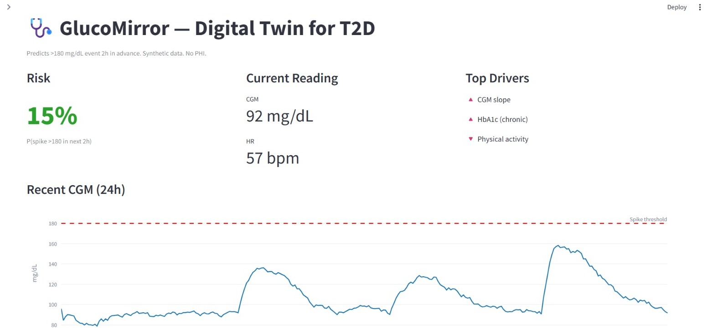

# Digital Twin Challenge 2026 — Submission

## Team & Institution
- **Team Leader:** Jyoshna Karri
- **Email:** karriudaya259@gmail.com
- **Unstop Team Handle:** kjyoshna2021
- **Institution:** _withheld per team preference — details available to organizers on request_

## Project Title
**GlucoMirror — A Digital Twin for Real-Time Glucose Spike Prediction in Type 2 Diabetes**

## Problem Statement & Healthcare Use Case
Type 2 diabetes management in India is reactive: patients and clinicians only see
glucose spikes after they happen. We will build a Digital Twin that fuses a
patient's static EHR (demographics, HbA1c, BMI, medications, comorbidities) with
real-time wearable time-series (CGM, heart rate, sleep, steps) to predict a
hyperglycemic event (>180 mg/dL) up to 2 hours in advance, and surface the top
drivers of that risk to a clinician through a dashboard — enabling pre-emptive
intervention instead of post-hoc reaction.

**Clinical action:** When risk exceeds threshold, clinician reviews the SHAP
drivers and adjusts lifestyle/insulin plan *before* the spike occurs.

## Technical Stack
- **Data:** Synthea (synthetic EHR), OhioT1DM + synthetic augmentation (wearables)
- **ML:** PyTorch (LSTM) + XGBoost + late fusion + SHAP explainability
- **Dashboard:** Streamlit + Plotly
- **Deployment:** Docker

## Model Formulation
Binary classification. Input = (EHR vector, last 4h CGM + HR + sleep window).
Output = P(CGM > 180 mg/dL within 120 min). Target AUC >= 0.80 on held-out
patients. Ablation: EHR-only vs sensor-only vs fusion.

## Demo Video
_Placeholder — 20-min unlisted YouTube link to be added_

## Architecture Diagram
See docs/architecture.pdf

## Data Provenance (Sandbox Compliance)
- No real patient data used. DPDP/HIPAA-safe.
- Synthea (Apache 2.0), OhioT1DM (research license, cited), PhysioNet (ODC-BY).

## License
MIT — see LICENSE.

## Dashboard Preview

The dashboard shows per-patient risk score, 24h CGM trend with spike threshold,
top risk drivers, and a what-if intervention slider.
